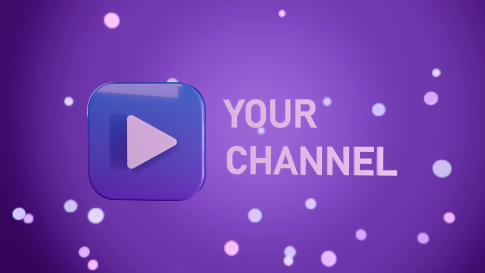

# Automated YouTube Posts

*[Português](README.pt-BR.md)*

Turn your project's progress into YouTube episodes with as little editing as possible: you talk to your phone,
the pipeline (and Claude Code, through the included skill) does the rest.

For each episode it produces:

- a **script** (`roteiro.html`) written from the commits since the last episode;
- a **long 16:9 video**: your intro full screen, then you in a framed corner over footage of each topic, straight into your
  channel's sting with music (a music-only close only when your script plans one). **No burned-in subtitles**: it writes `.srt` files for every language
  you publish in, to upload in YouTube Studio;
- one **9:16 Short per language** with burned-in word-by-word captions ("queimada" style: the word being said on a
  coloured box), cut right after your last word and crossfading into your sting with music.

Light previews come first; finals only after you approve them.

  




## How it works

```
commits since the last episode ─► roteiro.html ─► you record (phone, vertical)
                                        │
            b-roll / screen captures ◄──┘          transcribe (faster-whisper, word timings)
                                                         │
     episode.json (cuts, topics, Short lines) ◄──────────┘
                    │
   build_long ─► long video + .srt (main + translations)
   build_short ─► Short base per language ─► captions ─► Short per language
                    │
              previews ─► your OK ─► finalize ─► final/
```

## Requirements

- Python 3.10+, `pip install -r requirements.txt` (faster-whisper, Pillow)
- ffmpeg 6+ with libx264 on PATH (or `$FFMPEG` / `$FFPROBE`)
- Windows for the bundled defaults (fonts in `channel.json`, the demo's offline voice); change the font paths and
  the capture command to run elsewhere.
- Optional: [Claude Code](https://claude.com/claude-code); the skill in `.claude/skills/youtube-episode` drives
  the whole thing.

## Example results

The demo episode, as the pipeline made it: [long video](examples/demo/episode_demo_long.mp4) (16:9, no burned
subtitles) with its [pt](examples/demo/episode_demo_long.pt.srt) and [en](examples/demo/episode_demo_long.en.srt)
subtitles, [Short in Portuguese](examples/demo/episode_demo_short_pt.mp4) and
[Short in English](examples/demo/episode_demo_short_en.mp4).

## Quickstart: rebuild the demo

The demo needs no camera and no project: a narrated walkthrough of the workflow itself. Everything it starts from is
committed (`brand/`: logo, 3D stings, music; `demo/assets/`: the narration and the slides), so a clean clone
rebuilds it with no Blender, no text-to-speech and no browser:

```bash
pip install -r requirements.txt
python demo/make_demo.py                   # episodes/demo: takes, b-roll, episode.json, translations.json
python tools/transcribe.py episodes/demo/takes/intro.mp4
python tools/transcribe.py episodes/demo/takes/main.mp4
python tools/build_long.py episodes/demo
python tools/build_short.py episodes/demo
python tools/make_subs.py episodes/demo
python tools/captions.py episodes/demo pt
python tools/captions.py episodes/demo en
python tools/finalize.py episodes/demo     # episodes/demo/final: long + .srt, Short PT, Short EN
python tools/check_sums.py                 # compare with examples/demo (SHA-256)
```

With the same tool versions (below) the rebuild is identical byte for byte: a clean clone gave the same SHA-256
for all five files. Another ffmpeg/x264 build, faster-whisper version or font gives the same video, but not the
same bytes, so `check_sums.py` will say DIFFERENT.

Made with: Windows 11, Python 3.11.6, ffmpeg 7.1.1 (gyan.dev essentials build), faster-whisper 1.2.1 (ctranslate2
4.8.3, model large-v3-turbo, CPU int8), Pillow 12.3.0, numpy 1.26.2; fonts Arial Black and Arial Bold (captions,
labels). `python demo/make_demo.py --regenerate` re-makes the narration (Windows voice "Microsoft Maria Desktop")
and the slides (Edge or Chrome, headless); `python tools/make_brand.py --blender "<blender>"` re-makes the brand
(Blender 4.2+ for the 3D stings, a 2D version without it).

## Your own episodes

1. Edit `channel.json`: your channel name, `project_repo` (the code your episodes are about), languages,
   caption style. Replace `brand/` with your own logo, stings and music (keep the file names or change the paths).
2. `python tools/new_episode.py` creates `episodes/<today>/` and `changes.json`. With Claude Code, ask for an
   episode and the skill writes `roteiro.html` from it.
3. Record your takes (`takes/intro.mp4`, `takes/main.mp4`), capture footage into `broll/`.
4. Transcribe, fill `episode.json` (see `tools/episode.example.json`), build, translate (`translations.todo.json`
   -> `translations.json`), preview, finalize.

Episodes (your takes, your voice, all renders) are git-ignored and never leave your machine.

## License

MIT
