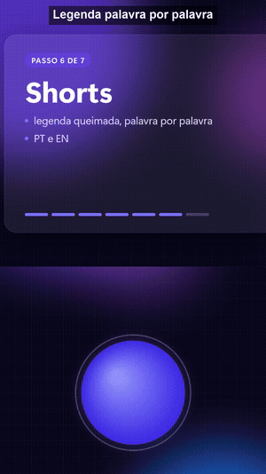
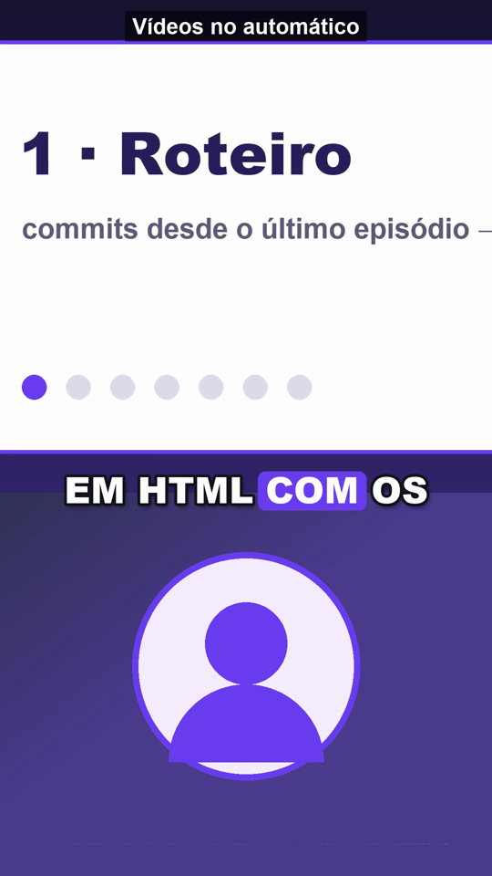
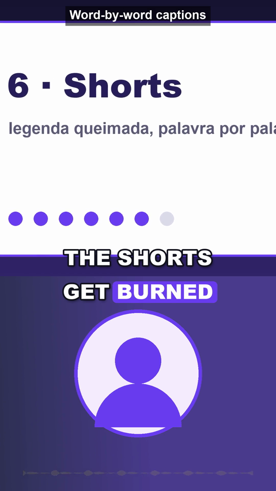
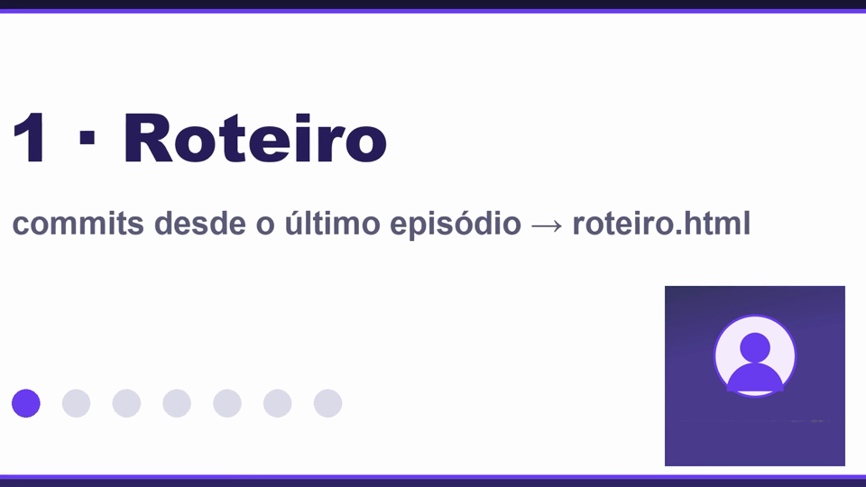

# Automated YouTube Posts

*[English](README.md)*

Transforme o progresso do seu projeto em episódios para o YouTube editando o mínimo possível: você fala para o
celular, e o fluxo (com o Claude Code, pela skill incluída) faz o resto.

Para cada episódio ele gera:

- um **roteiro** (`roteiro.html`) escrito a partir dos commits desde o último episódio;
- um **vídeo longo 16:9**: sua abertura em tela cheia, depois você num canto sobre as cenas de cada tópico, um
  final calmo com música e a vinheta do canal. **Sem legenda na imagem**: ele gera arquivos `.srt` em cada idioma
  para subir no YouTube Studio;
- um **Short 9:16 por idioma** com legenda queimada palavra por palavra (a palavra falada num quadro colorido),
  cortado logo depois da sua última palavra e com fusão para a vinheta com música.

Primeiro saem prévias leves; os finais só depois da sua aprovação.

  



## Requisitos

- Python 3.10+, `pip install -r requirements.txt` (faster-whisper, Pillow)
- ffmpeg 6+ com libx264 no PATH (ou `$FFMPEG` / `$FFPROBE`)
- Windows para os padrões incluídos (fontes no `channel.json`, a voz offline do demo); troque os caminhos das
  fontes e o comando de captura para rodar em outro sistema.
- Opcional: [Claude Code](https://claude.com/claude-code); a skill em `.claude/skills/youtube-episode` conduz tudo.

## Começo rápido (o demo)

O demo não precisa de câmera nem de projeto: ele narra o próprio fluxo com a voz offline do Windows.

```bash
python tools/make_brand.py                 # logo, vinhetas e música de placeholder em brand/
python demo/make_demo.py                   # episodes/demo: takes, cenas, episode.json, translations.json
python tools/transcribe.py episodes/demo/takes/intro.mp4
python tools/transcribe.py episodes/demo/takes/main.mp4
python tools/build_long.py episodes/demo
python tools/build_short.py episodes/demo
python tools/make_subs.py episodes/demo
python tools/captions.py episodes/demo pt
python tools/captions.py episodes/demo en
python tools/finalize.py episodes/demo     # depois de olhar a pasta preview/
```

## Seus episódios

1. Edite o `channel.json`: nome do canal, `project_repo` (o código sobre o qual são os episódios), idiomas e
   estilo da legenda. Troque o `brand/` pelo seu logo, vinhetas e música.
2. `python tools/new_episode.py` cria `episodes/<hoje>/` e o `changes.json`. Com o Claude Code, peça um episódio
   e a skill escreve o `roteiro.html`.
3. Grave os takes (`takes/intro.mp4`, `takes/main.mp4`) e as cenas em `broll/`.
4. Transcreva, preencha o `episode.json` (veja `tools/episode.example.json`), monte, traduza
   (`translations.todo.json` -> `translations.json`), veja as prévias e finalize.

Os episódios (seus takes, sua voz e todos os vídeos) ficam fora do git e não saem da sua máquina.

## Licença

MIT
